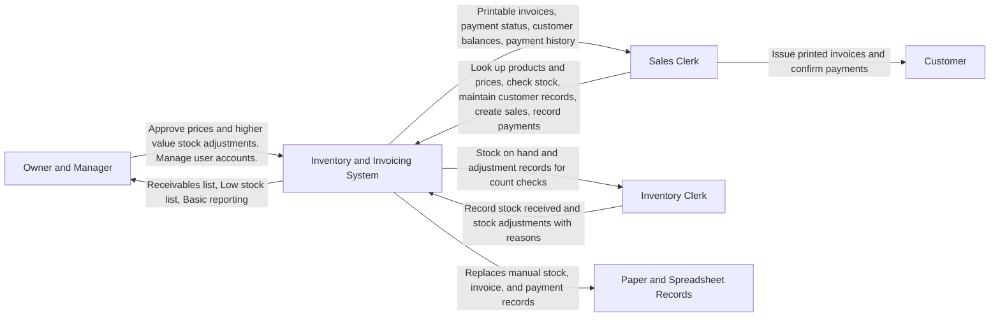
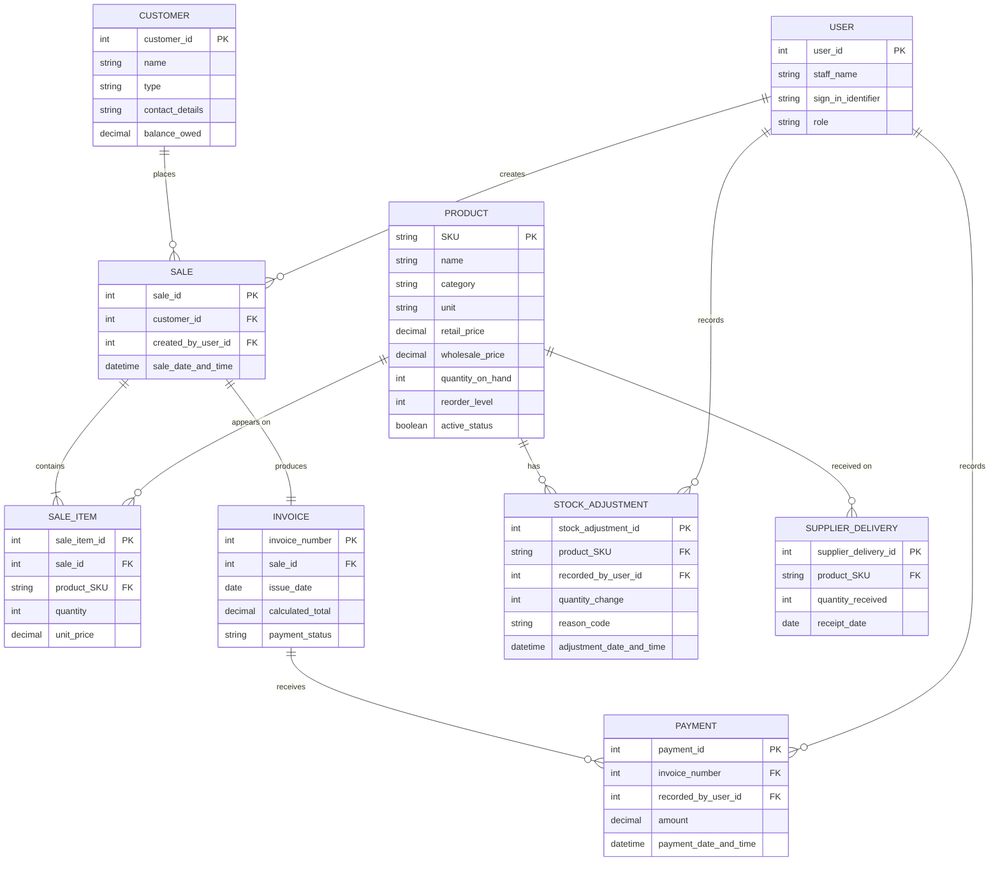

# System Context Diagram and Entity Relationship Diagram (Mermaid)

**Author** Brandon Narine
**Date** November 24, 2026
**Status** Phase 1 business analysis. The system has yet to be built.

This file holds the Mermaid versions of the system context diagram and the entity relationship diagram from `diagram-outlines.md`, so both render directly on GitHub. The content follows the outlines exactly. Polished draw.io versions remain a Phase 2 design activity, as recorded in the implementation roadmap.

## 1. System Context Diagram

The Inventory and Invoicing System sits at the centre. The three staff roles use it, the Customer receives printed invoices and payment confirmations without a system login, and the system replaces the paper and spreadsheet records used today.

## 2. Entity Relationship Diagram

Nine entities. Identifiers and foreign keys are marked on the attributes. Cardinalities in words, matching the outline: a Customer places zero or many Sales and each Sale belongs to one Customer; a completed Sale has one or more Sale Items; each completed Sale produces one Invoice; an Invoice receives zero or many Payments; a Product can have zero or many Stock Adjustments and Supplier Delivery records; a User can create Sales and record Payments and Stock Adjustments, and each of those records identifies one responsible User.

## Change log

| Version | Date | Change |
| --- | --- | --- |
| 1 | November 24, 2026 | Mermaid versions of the system context diagram and the entity relationship diagram, built from the approved diagram outlines. |
