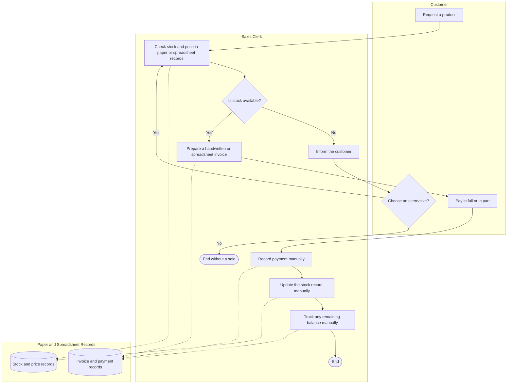
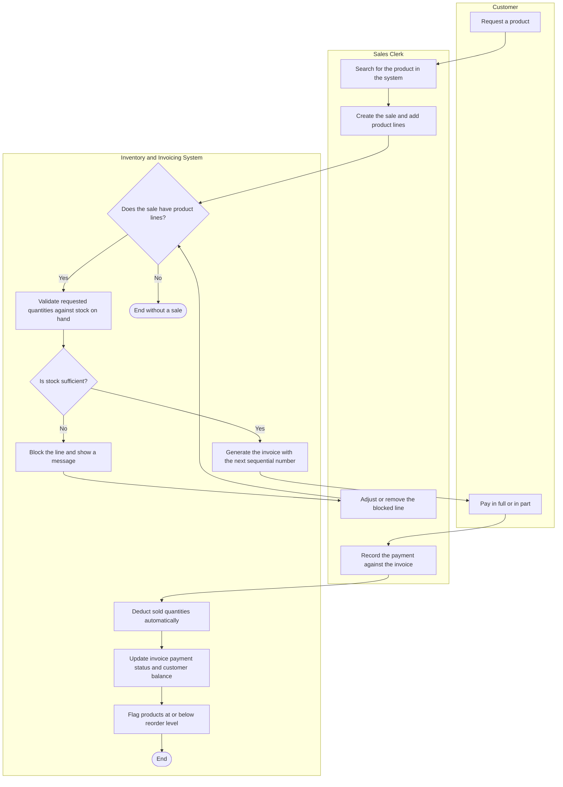

# Inventory and Invoicing System Process Flows

**Author** Brandon Narine  
**Date** November 24, 2026  
**Status** Draft for Phase 1 business analysis. The system has yet to be built.

These Mermaid versions of the current and future state process flows follow the diagram plan in Section 7 of the project spec and use BPMN swimlane conventions. The draw.io versions will be based on the same steps.

## Current state flow

Dotted lines identify the records the Sales Clerk consults or updates.

| Step | Actor | Step and notes | Related BR IDs |
| --- | --- | --- | --- |
| C1 | Customer | Requests a product. | |
| C2 | Sales Clerk | Checks stock and price in paper or spreadsheet records. Looking them up takes time, and recorded quantities can differ from the shelf count. | BR-01, BR-05, BR-06 |
| C3 | Sales Clerk | Determines whether stock is available from the manual check. | BR-06 |
| C4 | Sales Clerk | Tells the Customer the requested product is unavailable. | BR-06 |
| C5 | Customer | Chooses whether to request an alternative. If so, the Sales Clerk checks the alternative. | |
| C6 | Sales Clerk | Ends the interaction without a sale when the Customer declines an alternative. | |
| C7 | Sales Clerk | Prepares the invoice by hand or in a spreadsheet. Preparation takes time, and invoices can show charges and balances inconsistently. | BR-08 |
| C8 | Customer | Pays in full or in part. | BR-09 |
| C9 | Sales Clerk | Records the payment manually. | BR-09 |
| C10 | Sales Clerk | Updates the stock record separately from the sale. Records can drift from physical counts and provide neither reliable low stock warnings nor an audit trail for stock adjustments. | BR-07, BR-12, BR-19 |
| C11 | Sales Clerk | Tracks any remaining balance manually. Staff compare invoices and payment records to reconcile partial payments, and the owner uses those records to work out who owes money. | BR-10, BR-11 |
| C12 | Sales Clerk | Finishes processing the sale. | |

## Future state flow

| Step | Actor | Step and notes | Related BR IDs |
| --- | --- | --- | --- |
| F1 | Customer | Requests a product. | |
| F2 | Sales Clerk | Searches for the product in the system. | BR-01, BR-20 |
| F3 | Sales Clerk | Selects the Customer and enters product lines. Sale creation validates line quantities and prices, including the approved price for the customer type. | BR-04, BR-05 |
| F4 | Inventory and Invoicing System | Checks whether there are lines to validate. If the last line has been removed, the sale ends without an invoice. | BR-05 |
| F5 | Inventory and Invoicing System | Checks the requested quantities on the remaining lines against stock on hand. | BR-06 |
| F6 | Inventory and Invoicing System | Continues to invoicing when stock is sufficient for the sale. | BR-06 |
| F7 | Inventory and Invoicing System | Blocks a line that exceeds stock on hand and shows a message. | BR-06 |
| F8 | Sales Clerk | Adjusts or removes the blocked line and returns the sale to validation. | BR-06 |
| F9 | Inventory and Invoicing System | Ends the flow without a sale when no lines remain. | |
| F10 | Inventory and Invoicing System | Generates a printable, itemized invoice with the next unique sequential number, calculated totals, and payment status. | BR-08 |
| F11 | Customer | Pays in full or in part. | BR-09 |
| F12 | Sales Clerk | Records the payment against the invoice. | BR-09 |
| F13 | Inventory and Invoicing System | Deducts sold quantities once, as part of completing the sale in this flow. Later payments against the same invoice do not cause another deduction. | BR-07 |
| F14 | Inventory and Invoicing System | Updates invoice payment status and the Customer's outstanding balance. | BR-10 |
| F15 | Inventory and Invoicing System | Flags each affected product whose remaining quantity is at or below its reorder level. | BR-12 |
| F16 | Inventory and Invoicing System | Ends the flow. | |
