# Inventory and Invoicing System

This business analysis project specifies a web application for a fictional single-store electronics and accessories retailer serving retail and wholesale customers. It brings catalogue, stock, sales, invoices and payments into one proposed workflow so staff can validate availability and the owner can see low stock and unpaid balances. Phase 1, Business Analysis and Planning, is complete and ready to move into design and build. The system has yet to be built.

**At a glance** · 21 business requirements · 24 user stories · 44 functional requirements · 21 security requirements · 66 designed test cases · 9 planned UAT scenarios · Full traceability with no orphans  
**Data** · All sample data is invented. The project uses no real business data.  
**Author** · Brandon Narine  
**Overview PDF** · [OVERVIEW.pdf](OVERVIEW.pdf), the whole project condensed into one 16 page document. Start there if you only read one file.

## What this project demonstrates

- Requirements elicitation and documentation through stakeholder analysis, scope questions, measurable objectives and requirements.
- SDLC planning from discovery and process modelling through design, build, testing, acceptance and delivery.
- User stories, use cases, acceptance criteria, functional specifications, and security requirements based on OWASP ASVS Level 1.
- Positive, negative, boundary and security test design, UAT planning and end-to-end requirements traceability.

## Standards basis

The artifact set follows BABOK-aligned practice and uses ISO/IEC/IEEE 29148 for requirement quality, MoSCoW prioritization, Given/When/Then acceptance criteria, BPMN conventions for process flows and UML conventions for use cases. OWASP ASVS Level 1 guides the security requirements, with selected Level 2 controls for audit logging and separation of duties and OWASP Top 10 as the risk reference. BABOK describes practices and techniques. The artifact selection is deliberately complete for a showcase. A real engagement at this scale would typically combine and simplify deliverables.

## Life cycle

**Complete** · 1. Business Analysis and Planning  
**Planned** · 2. Design → 3. Build → 4. System Testing → 5. UAT → 6. Delivery and Go Live

## Reading guide

For a ten-minute review, spend two minutes on the BRD objectives and scope, three on the future-state flow and functional specification's business rules, and five on the coverage summary, UAT checks and implementation roadmap.

For a single-document read, start with the [Compact Edition](COMPACT_EDITION.md). It condenses the full set into a roughly fifteen-minute read. The full artifacts remain the source of truth.

## Key process diagrams

The two process diagrams show the manual counter workflow and the proposed system workflow. The future-state draft places F13 after counter payment. Functional Specification rule 3 specifies deduction at sale completion, including a sale with no counter payment. Artifact 8 records the diagram timing for reconciliation during design.

| Current state | Future state |
| --- | --- |
|  |  |

## Artifact index

| Artifact | Contents |
| --- | --- |
| 0. [Repository README](README.md) | Project framing, standards, process previews and reading guide. |
| 1. [Business Requirements Document](01-business-requirements-document.md) | Business problem, measurable outcomes and BR-01 through BR-21. |
| 2. [Stakeholder and Scope Analysis](02-stakeholder-and-scope-analysis.md) | Stakeholders, personas, Release 1 priorities and later-release boundaries. |
| 3. [Diagrams folder](03-diagrams/) | [Current and future process flows](03-diagrams/process-flows-mermaid.md) and [context, use case and ERD outlines](03-diagrams/diagram-outlines.md). |
| 4. [User Stories and Acceptance Criteria](04-user-stories-and-acceptance-criteria.md) | 24 estimated stories with Given/When/Then criteria and three structured use cases. |
| 5. [Functional Specification](05-functional-specification.md) | Screen descriptions, functional and security requirements, rules, permissions and audit controls. |
| 6. [Test Cases](06-test-cases.md) | 66 designed system test cases with fictional fixtures and expected results. |
| 7. [UAT Plan](07-uat-plan.md) | Nine planned business scenarios, operational checks and owner sign off. |
| 8. [Traceability Matrix](08-traceability-matrix.md) | Coverage from business requirements to system testing and UAT, plus the 27-item open register. |
| 9. [Implementation Roadmap](09-implementation-roadmap.md) | Six delivery phases, Release 1 build order and later-release scope. |
| [Compact Edition](COMPACT_EDITION.md) | Single-document summary with requirements, rules, permissions and coverage. |
| 10. [PDF export pack](pdf/) | [Combined full set](pdf/inventory-invoicing-system-ba-full-set.pdf), [Compact Edition](pdf/inventory-invoicing-system-ba-compact-edition.pdf) and individual artifact exports. |
